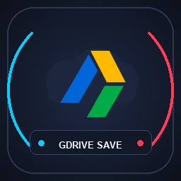
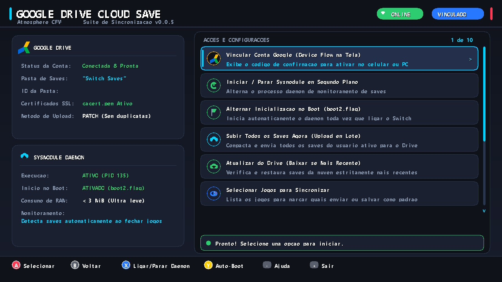

# ☁️ Nintendo Switch - Google Drive Cloud Save Suite

<p align="center">
  
</p>

<p align="center">
  <b>Sincronização manual, sob demanda e segura dos seus saves de jogos do Nintendo Switch direto para o Google Drive. Zero consumo de RAM em segundo plano e compatibilidade total com Ultrahand.</b>
</p>

<p align="center">
  
  
  
  
  
</p>

<p align="center">
  
</p>

---

## 📌 Sumário
1. [Visão Geral](#-visão-geral)
2. [Novidades da Versão 0.0.8 (Modo 100% Sob Demanda)](#-novidades-da-versão-008)
3. [Novidades da Versão 0.0.7](#-novidades-da-versão-007)
4. [Novidades da Versão 0.0.6](#-novidades-da-versão-006)
5. [Componentes da Suite](#-componentes-da-suite)
6. [Como Funciona (Arquitetura)](#-como-funciona-arquitetura)
7. [Instalação Rápida no Cartão SD](#-instalação-rápida-no-cartão-sd)
8. [Configuração das Credenciais do Google Drive](#-configuração-das-credenciais-do-google-drive)
9. [Vinculando sua Conta pelo Switch](#-vinculando-sua-conta-pelo-switch)
10. [Controles e Navegação do Aplicativo](#-controles-e-navegação-do-aplicativo)
11. [Certificados SSL e Criptografia](#-certificados-ssl-e-criptografia)
12. [Perguntas Frequentes e Resolução de Problemas](#-perguntas-frequentes-e-resolução-de-problemas)
13. [Como Compilar do Código-Fonte](#-como-compilar-do-código-fonte)

---

## 🌟 Visão Geral

O **Google Drive Cloud Save Suite** transforma o seu Nintendo Switch desbloqueado em uma central moderna de backup e restauração em nuvem, similar aos serviços da Nintendo Switch Online, Steam Cloud ou Xbox Cloud, mas utilizando a **sua própria conta pessoal do Google Drive** com armazenamento gratuito ou pago.

A partir da **versão 0.0.8**, a suite funciona de forma **100% sob demanda e manual**: você abre o aplicativo pelo Homebrew Menu quando desejar sincronizar, garantindo **zero consumo de memória RAM e zero impacto de CPU** durante os seus jogos, além de total compatibilidade com **Ultrahand** e outros overlays do Atmosphère.

### Principais Destaques:
* 🚀 **Zero RAM em Segundo Plano (100% Sob Demanda):** O daemon em segundo plano foi completamente eliminado. Seus jogos e overlays têm 100% dos recursos do console disponíveis o tempo todo.
* 🕹️ **Compatibilidade Perfeita com Ultrahand:** O menu de overlays (Tesla / Ultrahand) abre imediatamente via `LS + RS` sem lentidões, disputas de System Pool ou falhas `Result 0x1159`.
* 🗂️ **Zero Bagunça no Google Drive:** Cria automaticamente a pasta `Switch Saves` e gerencia atualizações inteligentes via requisições `PATCH` (sobrescrevendo o save anterior) e `POST` (criando novos saves), sem duplicar arquivos nem lotar sua lixeira.
* 🔐 **Detecção por Hash CRC32 e Timestamps:** O sistema valida integridade via CRC32 e compara os carimbos de data/hora (Drive vs. Local) com proteção estrita de sanidade do relógio RTC do console.
* 📦 **Upload Manual em Lote ou Seletivo:** Envie todos os seus saves de uma vez ou selecione individualmente quais jogos você deseja enviar para o Drive, salvando sua lista de favoritos diretamente na memória.
* ⬇️ **Restauração Inteligente e Segura:** Baixa e atualiza saves da nuvem exclusivamente se a versão do Google Drive for mais recente que a local, com backup preventivo e commit atômico na memória flash (`fsdevCommitDevice`).
* 🎨 **Interface Gráfica Nativa de Alta Qualidade:** Aplicativo Homebrew (.NRO) moderno renderizado a 720p nativo @ 60 FPS, com visual escuro, destaques Joy-Con Neon, modais interativas e suporte ao teclado oficial do Switch.

---

## 🚀 Novidades da Versão 0.0.8

Esta versão traz uma reestruturação fundamental atendendo diretamente à estabilidade do console e desempenho nos jogos:

1. **Eliminação do Daemon em Background (Zero RAM & CPU):**
   - O sysmodule daemon (`atmosphere/contents/4200000000000010/`) foi completamente descomissionado.
   - Todo o sincronismo agora é executado sob demanda diretamente pelo aplicativo gráfico Homebrew (`gdrive-sync.nro`).
   - Zero concorrência de descritores de arquivo do Horizon OS durante o fechamento de jogos.
2. **Correção e Estabilidade Total do Ultrahand / Tesla Overlays:**
   - Restaurados 100% do System Memory Pool do Atmosphère (`pool_partition: 2`), eliminando panes de Out of Memory / Result `0x1159`.
   - Limpeza de arquivos órfãos em `atmosphere/contents/4200000007e51a/` e ajuste de responsividade (`hold_duration=500` ms) no `config/ultrahand/config.ini`.
3. **Novo Menu Principal Simplificado (8 Ações Diretas):**
   - **[0] Subir Todos os Saves Agora (Upload em Lote):** Compacta e envia todos os saves do usuário ativo de uma só vez.
   - **[1] Atualizar do Drive (Baixar se Nuvem for Mais Recente):** Restauração inteligente comparando carimbos UTC com trava protetiva de RTC < 2025.
   - **[2] Selecionar Jogos para Sincronizar:** Gerenciador seletivo individual de jogos com atalho `[X]` para salvar favoritos.
   - **[3] Vincular Conta Google:** Fluxo Device Flow OAuth 2.0 nativo na tela do console.
   - **[4] Validar / Criar Pasta de Saves no Drive:** Garante a estrutura na nuvem.
   - **[5] Configurar Google OAuth Client ID:** Edição via teclado virtual nativo.
   - **[6] Configurar Google OAuth Client Secret:** Edição via teclado virtual nativo.
   - **[7] Alterar Nome da Pasta de Destino no Drive:** Personalização do diretório de destino.
4. **Remoção de Dependências Obsoletas:**
   - Eliminadas as conexões aos serviços `pm:dmnt` e `pm:shell`, tornando a aplicação mais leve, segura e rápida para iniciar e fechar.

---

## 🚀 Novidades da Versão 0.0.7

Esta versão foca em **resiliência industrial de conectividade, eliminação de gargalos de rede e garantia total de sincronização**:

1. **Renovação Antecipada de Tokens OAuth e Fim das Pastas Duplicadas:**
   - Chamada mandatória de `refreshAccessToken()` antes de qualquer listagem, criação ou upload na Google Drive API v3.
   - Ordenação estrita das buscas por data de criação (`&orderBy=createdTime`), eliminando a criação indevida de pastas duplicadas (`Switch Saves (1..9)`) e vinculando permanentemente à pasta mestre.
2. **Expansão do Heap do Sysmodule para 3.5 MiB:**
   - Aumento da memória estática `.bss` de 1.5 MiB para 3.5 MiB (`0x380000`), extinguindo falhas `CURLE_WRITE_ERROR` e out-of-memory durante handshakes TLS e uploads de arquivos grandes em background.
3. **Purga Automática de Jobs Fantasmas (`stat()`):**
   - Eliminação do loop infinito de `fopen zip failed` na fila persistente: jobs de arquivos que já foram transmitidos ou removidos são expurgados imediatamente.
4. **Resolução de Concorrência de Arquivos Temporários:**
   - Nomes de arquivos de streaming de payload tornados estritamente únicos por TitleID e timestamp (`up_stream_<TID>_<timestamp>.tmp`), evitando bloqueios mútuos entre GUI e daemon.
5. **Atualização Dinâmica do Perfil Ativo:**
   - Identificação do UID real de saves criados por perfis secundários durante o fechamento de processos via `FsSaveDataInfoReader`.
6. **Sincronização em Lockstep (Versionamento + Raiz):**
   - Todo upload atualiza paralelamente a pasta versionada append-only (`Switch Saves/<TitleID>/<AccountUid>/`) e o arquivo raiz (`Switch Saves/save_<TitleID>.zip`), assegurando sincronia em tempo real com o PC e o app GUI.
7. **Suítes de Testes Automatizadas e Deploy via MTP:**
   - Adicionadas 4 suítes de testes em PowerShell (`tests/`) cobrindo 100% dos fluxos de autenticação, integridade de arquivos .zip e integridade dos arquivos no Switch via MTP.

---

## 🚀 Novidades da Versão 0.0.6

Esta versão implementa a **refatoração arquitetural completa em 3 partes** com foco em robustez, separação estrita de responsabilidades e segurança transacional:

1. **Sysmodule Produtor Append-Only (Estritamente Read-Only):**
   - **Toda e qualquer rotina de escrita ou restore em `save:/` foi removida do sysmodule.**
   - O daemon opera em modo 100% somente leitura (`fsdevMountSaveDataReadOnly`), protegendo os dados locais de corrupção ou travamentos no encerramento de processos.
2. **Máquina de Estados Explícita (`SyncState`):**
   - Controle determinístico em 10 estados: `IDLE`, `PROCESS_EXIT_DETECTED`, `WAIT_LOCKS`, `MOUNT_READONLY`, `SNAPSHOT_PREPARE`, `COMPRESS`, `UPLOAD`, `CLEANUP`, `FAILURE_RECOVERY`, `DISABLED`.
   - Estado `WAIT_LOCKS` com delay protetivo calibrado de 3.5 segundos eliminando race conditions do Horizon OS.
   - Loop principal não-bloqueante a 100ms de ciclo, com consumo praticamente nulo de CPU.
3. **Snapshots Versionados e Fila Persistente em Disco:**
   - Snapshots nomeados com padrão append-only:
     `sdmc:/config/gdrive-sync/temp/<TitleID>_<AccountUid>_<TimestampUTC>_<CRC32>.zip`
   - Armazenamento hierárquico versionado no Google Drive: `Switch Saves/<TitleID>/<AccountUid>/`.
   - Fila de trabalhos persistida em JSON individual em `sdmc:/config/gdrive-sync/pending/<jobId>.json`.
   - **Regra de Ouro:** O snapshot local só é apagado após confirmação de sucesso HTTP 200/201 do Google Drive.
4. **Módulos Especializados da Aplicação GUI (`gui/`):**
   - **`OAuthManager`:** Gerenciamento isolado do fluxo RFC 8628 (Google Device Flow) com polling e persistência atômica.
   - **`DriveVersionManager`:** Consulta a API v3 retornando versões cronológicas com data/hora UTC legível, CRC32 e tamanho.
   - **`RestoreManager`:** Ação destrutiva com backup preventivo antes de sobrescrever (`sdmc:/config/gdrive-sync/backups/<TitleID>_before_restore_<timestamp>.zip`), commit obrigatório na partição (`fsdevCommitDevice`) e **rollback automático** em caso de erro.
   - Registro de auditoria em `sdmc:/config/gdrive-sync/restore.log`.

---

1. **Conversão Precisa de Timestamp (RFC 3339 / ISO 8601 UTC -> `time_t`):**
   - Utilização do algoritmo civil de Howard Hinnant para cálculo de Unix Epoch diretamente em segundos UTC.
   - 100% livre de desvios por fuso horário local ou configurações regionais do console.
   - Suporte a frações de segundo (`.000Z`) e offsets explícitos (`+HH:MM` / `-HH:MM`).

2. **Validação de Sanidade do Hardware RTC (Console Switch):**
   - Proteção de segurança temporal ativa: antes de comparar datas para decidir se deve restaurar saves da nuvem, o sistema verifica se o relógio do console é válido e posterior a **01/01/2025** (`MIN_SANE_RTC_TIMESTAMP = 1735689600`).
   - Impede desastres de perda de dados causados por bateria descarregada, modo avião ou reinicializações onde o relógio reseta para 1970 ou 2000. Nesses casos, o restore automático é bloqueado e uma tela explicativa é exibida.

3. **Backup de Segurança Pré-Restore com Rollback Transacional Automático:**
   - Antes de descompactar o novo `.zip` sobre os arquivos da partição `save:/`, o sistema cria um backup preventivo no SD (`<TitleID>_save_backup.bak`).
   - Se ocorrer qualquer falha durante a descompactação, espaço insuficiente ou erro no commit do Horizon OS, o sistema executa **Rollback Automático**, restaurando os arquivos originais locais e garantindo que o progresso do jogo nunca seja corrompido.
   - Caso a restauração e o commit sejam 100% bem-sucedidos, o `.bak` temporário é removido.

4. **Interface Gráfica com Scroll Vertical e Ícones Procedurais:**
   - Menu com 6 cards espaçosos por visualização, scrollbar dinâmico com navegação por D-Pad / analógico e ícones procedurais dedicados para todas as 10 opções.

---

## 🚀 Novidades da Versão 0.0.3

Esta versão consolida a maturidade do projeto com foco em resiliência contra condições de corrida do Horizon OS, gerenciamento enxuto de memória RAM/heap, restauração inteligente e logs persistentes:

1. **Resolução de Race Condition no Encerramento de Jogos (File Lock no Horizon OS):**
   - O Horizon OS leva alguns segundos para descarregar o cache de save e fechar os descritores de arquivo após a finalização do processo do jogo.
   - O delay pós-término foi ampliado para **3.5 segundos**, acompanhado de um **retry loop com backoff exponencial** (até 3 tentativas) em caso de partição ocupada (`0x202` / `FsError_PartitionBusy`).

2. **Detecção e Mapeamento Preciso de Saves por Usuário:**
   - Obtenção do perfil ativo via `accountGetPreselectedUser` (perfil que iniciou o jogo), com fallback para `accountGetLastOpenedUser` e varredura de contas locais.
   - Fallback de partição: se o perfil ativo não possuir save para o jogo, o sistema busca e mapeia automaticamente o UID do perfil local correto.
   - Suporte adicional a dados de dispositivo (`FsSaveDataType_Device`).
   - Validação prévia de integridade: aborta o empacotamento se a partição estiver vazia (`0` arquivos), prevenindo a geração de ZIPs corrompidos.

3. **Gerenciamento Estrito de Heap e RAM (Sysmodule & libcurl):**
   - Buffers de compactação zlib em streaming contínuo direto no SDMC padronizados em blocos de **32 KB** (`STREAM_BUFFER_SIZE = 32 * 1024`).
   - `CURLOPT_BUFFERSIZE` configurado em **16 KB** para todas as requisições HTTP (`POST`, `PATCH`, `GET`), economizando memória no System Pool do Atmosphere.
   - Renovação proativa do token de acesso OAuth 2.0 antes de iniciar montagens de requisições multipart.

4. **Tratamento Automático de Saves na Lixeira do Google Drive:**
   - Detecção inteligente no `findFileInFolder`: caso o arquivo do save esteja na lixeira do Drive, o cliente executa automaticamente um `PATCH {"trashed": false}`, restaurando e atualizando a versão existente sem criar arquivos duplicados ou órfãos.

5. **Sistema de Log Persistente Padronizado (`sync.log`):**
   - Registro cronológico e detalhado gravado em `sdmc:/config/gdrive-sync/sync.log` com timestamps legíveis:
     - Detecção de término de processo com TitleID.
     - Tentativas e status da montagem (`Mount save: SUCCESS/FAILED`).
     - Geração do ZIP com caminho, hash CRC32 e tamanho em bytes.
     - Chamada à API Google Drive com File ID retornado e código de status HTTP.

6. **Atualizar do Drive (Restauração Inteligente no Menu Principal):**
   - Novo botão dedicado no menu principal da interface Homebrew (.NRO).
   - Compara o timestamp UTC (`modifiedTime`) de cada save na pasta do Google Drive com o timestamp local do save no console (`timestamps.json` ou data dos arquivos internos).
   - Se `Timestamp_Drive > Timestamp_Local`: realiza o download do arquivo ZIP em chunks com barra de progresso, cria backup de segurança do save anterior em `sdmc:/config/gdrive-sync/backups/<TitleID>_backup.zip`, descompacta em `save:/` e executa **`fsdevCommitDevice("save")`** para persistência obrigatória na NAND/SD.

7. **Upload Manual em Lote ou Seletivo com Nomes Reais dos Jogos:**
   - Opções para subir todos os saves de uma só vez ou selecionar jogos individualmente através de uma lista interativa com suporte aos metadados oficiais (`ns` / `nacp`) e modo whitelist persistente.

8. **Tolerância a Comunicação Local (LDN / Y-Comm) com Espera de 1 Minuto:**
   - Aguarda até 60 segundos pela reconexão automática com o roteador Wi-Fi após fechar jogos como Pokémon Sword/Shield antes de enviar o save ou salvar na fila offline.

---

## 📦 Componentes da Suite

| Componente | Tipo | Caminho no SD | Descrição |
| :--- | :--- | :--- | :--- |
| **Google Drive Sync** | Aplicativo (`.nro`) | `sdmc:/switch/gdrive-sync/gdrive-sync.nro` | Interface visual completa aberta pelo Homebrew Menu para configurar credenciais, parear conta, testar conexão, listar, subir e restaurar saves com segurança e **zero consumo de RAM em background**. |
| **Configurações** | Arquivo JSON | `sdmc:/config/gdrive-sync/config.json` | Armazena tokens OAuth 2.0 (access_token, refresh_token), client_id, client_secret, folder_id, modo de sincronização e títulos favoritos. |
| **Certificados SSL** | Arquivo PEM | `sdmc:/config/gdrive-sync/cacert.pem` | Certificados de autoridade de certificação (Mozilla CA) essenciais para conexão HTTPS/TLS segura com o Google Drive. |
| **Logs de Diagnóstico** | Arquivo Texto | `sdmc:/config/gdrive-sync/sync.log` | Registra detalhes operacionais com timestamps UTC, hashes CRC32, códigos HTTP e auditoria de restaurações. |

> [!NOTE]
> **Aviso sobre o Daemon Antigo:** A partir da versão **v0.0.8**, o sysmodule em segundo plano (`sdmc:/atmosphere/contents/4200000000000010/`) foi descontinuado e deve ser removido do cartão SD para liberar a memória e prevenir conflitos com o Ultrahand.

---

## ⚙️ Como Funciona (Arquitetura Sob Demanda)

```text
   [ JOGADOR ] ──> Joga normalmente com 100% de CPU/RAM livres e Ultrahand 100% fluido!
        │
        ▼ Quando desejar sincronizar os dados:
   [ HOMEBREW MENU ] ──> Abre "Google Drive Sync" (gdrive-sync.nro)
        │
        ├── [Opção 1] SUBIR TODOS OS SAVES (Lote):
        │     - Identifica o usuário ativo no Switch
        │     - Compacta os saves de cada jogo instalado em .zip
        │     - Envia para o Drive atualizando a pasta raiz e o snapshot versionado
        │
        ├── [Opção 2] ATUALIZAR DO DRIVE (Download Inteligente):
        │     - Valida a sanidade do relógio RTC do console (trava anti-corrupção se < 2025)
        │     - Compara Timestamp_Drive vs Timestamp_Local
        │     - Se Drive > Local: faz backup preventivo, baixa o .zip, limpa partição e comita (fsdevCommitDevice)
        │
        └── [Opção 3] SELECIONAR JOGOS PARA SINCRONIZAR:
              - Lista jogos com títulos reais
              - Permite selecionar quais enviar e marcar favoritos com [X]
```

---

## 🚀 Instalação Rápida no Cartão SD

Se você está com o Nintendo Switch conectado ao computador (via DBI em modo MTP, leitor de cartão ou FTP), a estrutura de pastas no cartão SD deve ficar exatamente assim:

```text
sdmc:/ (Raiz do Cartão SD)
 ├── switch/
 │    └── gdrive-sync/
 │         └── gdrive-sync.nro          <-- Aplicativo gráfico com ícone na interface (v0.0.8)
 └── config/
      └── gdrive-sync/
           ├── config.json              <-- Suas chaves OAuth (client_id, secret, tokens)
           ├── cacert.pem               <-- Certificados SSL de validação HTTPS
           ├── sync.log                 <-- Log de operações e diagnósticos
           └── temp/                    <-- Diretório temporário para processamento de arquivos ZIP
```

> [!IMPORTANT]
> **Upgrade da v0.0.7 para a v0.0.8:**
> Se você utilizava uma versão anterior com o daemon em segundo plano, **delete a pasta** `sdmc:/atmosphere/contents/4200000000000010/` do seu cartão SD. Isso devolverá 100% da memória do sistema ao console e restaurará o funcionamento perfeito do **Ultrahand Overlay**!

---

## 🔑 Configuração das Credenciais do Google Drive

Para que o aplicativo possa se conectar com a sua conta Google, é necessário criar um identificador OAuth no Google Cloud Console (processo 100% gratuito e leva cerca de 3 minutos):

### Passo 1: Criar o Projeto
1. Acesse o [Google Cloud Console](https://console.cloud.google.com/) com a sua conta Google.
2. No menu superior, clique em **Selecionar Projeto** e depois em **Novo Projeto**.
3. Dê um nome como `Switch Cloud Save` e clique em **Criar**.

### Passo 2: Ativar a API do Google Drive
1. No menu lateral esquerdo, vá em **APIs e Serviços** > **Biblioteca**.
2. Na barra de pesquisa, digite `Google Drive API`.
3. Clique sobre o resultado e clique no botão azul **Ativar**.

### Passo 3: Configurar a Tela de Consentimento OAuth
1. No menu lateral, acesse **APIs e Serviços** > **Tela de permissão OAuth**.
2. Selecione o tipo de usuário **Externo** e clique em **Criar**.
3. Preencha apenas o básico:
   - **Nome do app:** `Switch Cloud Save`
   - **E-mail de suporte ao usuário:** seu próprio e-mail
   - **Dados de contato do desenvolvedor:** seu próprio e-mail
4. Clique em **Salvar e continuar**.
5. Na aba **Escopos**, clique em **Adicionar ou remover escopos**, marque o escopo:
   - `.../auth/drive.file` *(Ver, criar e editar apenas os arquivos usados por este app)*
   - Clique em **Atualizar** e depois em **Salvar e continuar**.
6. Na aba **Usuários de teste**, clique em **+ Add users** e digite o seu endereço de e-mail da conta Google. Clique em **Salvar e continuar**.

### Passo 4: Criar as Credenciais do Dispositivo
1. No menu lateral, clique em **Credenciais**.
2. Clique no botão superior **+ Criar credenciais** e selecione **ID do cliente OAuth**.
3. No campo **Tipo de aplicativo**, selecione:
   - 👉 **TVs e dispositivos com entrada limitada** *(TVs and Limited Input devices)*.
4. Dê o nome que preferir (ex: `Nintendo Switch`) e clique em **Criar**.
5. Uma janela exibirá o seu **ID do cliente** (`Client ID`) e a **Chave secreta do cliente** (`Client Secret`).

---

## 📱 Vinculando sua Conta pelo Switch

Você pode inserir o `client_id` e o `client_secret` de duas formas muito fáceis:

### Método A: Pelo computador no arquivo `config.json` (Mais Rápido)
Abra o arquivo `sdmc:/config/gdrive-sync/config.json` em qualquer editor de texto no seu PC e preencha:

```json
{
  "client_id": "SEU_CLIENT_ID_AQUI.apps.googleusercontent.com",
  "client_secret": "SEU_CLIENT_SECRET_AQUI",
  "refresh_token": "",
  "access_token": "",
  "token_expires_at": 0,
  "folder_id": "",
  "folder_name": "Switch Saves",
  "sync_mode": "all",
  "tracked_titles": []
}
```

### Método B: Pelo teclado virtual na tela do Switch
1. Inicie o Switch e abra o **Homebrew Menu** via **Title Override** (segure **[R]** ao abrir qualquer jogo instalado, como Zelda BOTW).
2. Abra o aplicativo **Google Drive Cloud Save**.
3. Pressione a opção de editar `Client ID` ou `Client Secret`: o teclado oficial do Horizon OS surgirá na tela para você digitar diretamente.

### Finalizando o Pareamento:
1. Dentro do aplicativo no Switch, selecione a opção **`VINCULAR CONTA GOOGLE (DEVICE FLOW NA TELA)`**.
2. Uma janela elegante se abrirá mostrando:
   - O endereço de acesso: `https://www.google.com/device`
   - Um código de 8 dígitos (exemplo: `ABCD-EFGH`).
3. No seu celular ou computador, abra o navegador, entre no link informado e digite o código de 8 dígitos.
4. Escolha sua conta Google e clique em **Permitir**.
5. **Pronto!** Em menos de 2 segundos a tela do Switch detectará a aprovação automaticamente, baixará os tokens com segurança e exibirá a confirmação de sucesso com o nome da sua pasta de saves.

---

## 🎮 Controles e Navegação do Aplicativo

### Menu Principal (8 Ações Diretas)
| Opção / Botão | Ação |
| :--- | :--- |
| **[0] Subir Todos os Saves Agora** | Compacta e envia todos os saves do usuário ativo em lote para o Drive com barra de progresso. |
| **[1] Atualizar do Drive** | Compara timestamps UTC e baixa/restaura da nuvem saves mais recentes com backup de segurança e commit. |
| **[2] Selecionar Jogos para Sincronizar** | Abre a lista seletiva interativa de jogos com nomes reais e suporte a favoritos. |
| **[3] Vincular Conta Google** | Inicia o pareamento OAuth 2.0 Device Flow diretamente na tela. |
| **[4] Validar / Criar Pasta no Drive** | Testa a conectividade com a API e garante a pasta mestre no Google Drive. |
| **[5] Configurar Client ID** | Abre o teclado virtual oficial do Switch para editar o Client ID. |
| **[6] Configurar Client Secret** | Abre o teclado virtual oficial do Switch para editar o Client Secret. |
| **[7] Alterar Nome da Pasta de Destino** | Altera o nome da pasta de backup principal no Drive (padrão: `Switch Saves`). |
| **D-Pad / Analógico** | Navega verticalmente com rolagem suave entre os cards. |
| **Botão (A)** | Executa a ação selecionada ou abre o teclado virtual. |
| **Botão (B)** | Fecha o aplicativo e retorna ao menu anterior. |
| **Botão (-)** | Abre a tela de Guia Rápido e Ajuda. |
| **Botão (+)** | Encerra o aplicativo com segurança. |

### Tela de Seleção de Jogos ("Selecionar Jogos para Sincronizar")
| Botão | Ação |
| :---: | :--- |
| **D-Pad / Analógico Cima/Baixo** | Navega pela lista de jogos instalados (com rolagem suave). |
| **Botão (A)** | Marca ou desmarca o jogo (`[X]` / `[ ]`). |
| **Botão (Y)** | Marca todos ou desmarca todos os jogos de uma vez. |
| **Botão (X)** | Salva os jogos marcados como **Favoritos** persistentes. |
| **Botão (+)** | Inicia imediatamente o upload apenas dos jogos selecionados. |
| **Botão (B)** | Cancela e volta para o menu principal. |

---

## 🔒 Certificados SSL e Criptografia

Todas as trocas de dados entre o console e os servidores da Google são protegidas por criptografia **TLS 1.2 / TLS 1.3** através da biblioteca `mbedTLS`. 

Para validação das Autoridades Certificadoras (CA) da Google, a suite utiliza o arquivo padrão da Mozilla `cacert.pem`. Ele deve ficar localizado em:
`sdmc:/config/gdrive-sync/cacert.pem`

---

## ❓ Perguntas Frequentes e Resolução de Problemas

### 1. Por que a suite agora é 100% manual sob demanda e não tem mais daemon em segundo plano?
Na versão v0.0.8, o daemon em segundo plano foi eliminado para garantir **zero consumo de RAM e zero impacto de CPU** enquanto você joga. Em consoles desbloqueados, sysmodules em background disputam o pool limitado de memória de sistema do Atmosphère (`pool_partition: 2`) com módulos essenciais (como *sys-clk*, *emuiibo*, *missioncontrol* e o *Ultrahand/Tesla Overlay*). Ao tornar a sincronização sob demanda no app Homebrew, o Switch ganha estabilidade absoluta e desempenho máximo.

### 2. O que foi feito para consertar o Ultrahand Overlay?
O Ultrahand / `nx-ovlloader` (`420000000007E51A`) estava falhando por concorrência de heap no Atmosphere. Com a remoção do daemon antigo, 100% do System Memory Pool foi devolvido ao sistema. Além disso, foram purgados arquivos órfãos em `contents/420000000007E51A/` e o tempo de acionamento em `sdmc:/config/ultrahand/config.ini` foi ajustado de 3000ms para 500ms (`hold_duration=500`), permitindo abrir o menu de overlays imediatamente ao pressionar `LS + RS` ou `ZL + ZR + D-Pad Baixo`.

### 3. Como funciona a proteção contra perda de saves no download?
Antes de restaurar qualquer save vindo da nuvem:
1. **Validação do Relógio RTC:** O app checa se a data do Switch é posterior a 2025. Se o console esteve sem bateria e resetou o ano para 1970 ou 2000, o download automático é bloqueado para não sobrescrever saves válidos com datas antigas.
2. **Comparação Estrita de Timestamps:** O save só é baixado se a versão da nuvem for estritamente mais recente que a do console (`Drive_Timestamp > Local_Timestamp`).
3. **Backup Preventivo:** Um backup de segurança do save local é gerado no SD antes de qualquer alteração.
4. **Commit Atômico:** Após a extração dos arquivos em `save:/`, é chamada a função `fsdevCommitDevice("save")` para gravação definitiva na memória NAND/SD.

### 4. Posso acessar os saves pelo computador ou celular?
Sim! O aplicativo sincroniza os arquivos diretamente na sua pasta do Google Drive (`Switch Saves/`). Você pode baixar os arquivos `.zip` tanto da pasta raiz quanto do histórico versionado (`Switch Saves/<TitleID>/<AccountUid>/`) e restaurá-los em emuladores (Ryujinx/Yuzu) ou em outro console usando ferramentas como **JKSV** ou **Checkpoint**.

---

## 🛠️ Como Compilar do Código-Fonte

### Compilação Automatizada (Recomendada via GitHub Actions)
O repositório possui uma pipeline CI configurada em `.github/workflows/build.yml`. Ao fazer qualquer `push` para a branch `main`:
1. Um container oficial `devkitpro/devkita64:latest` compila o Sysmodule e o aplicativo GUI.
2. O pacote pronto para o SD é publicado automaticamente como artefato para download.

### Compilação Local com devkitPro
Caso tenha o ambiente devkitPro instalado localmente no seu computador:

```bash
# 1. Instalar as dependências do Switch:
dkp-pacman -S switch-dev switch-curl switch-mbedtls switch-zlib

# 2. Compilar tudo e montar o pacote SD:
make dist
```

O diretório `./dist` será gerado pronto para cópia direta no cartão SD do Switch.

---

<p align="center">
  Desenvolvido com carinho para a comunidade do Nintendo Switch. Tenha seus saves sempre seguros! 🛡️🕹️
</p>
